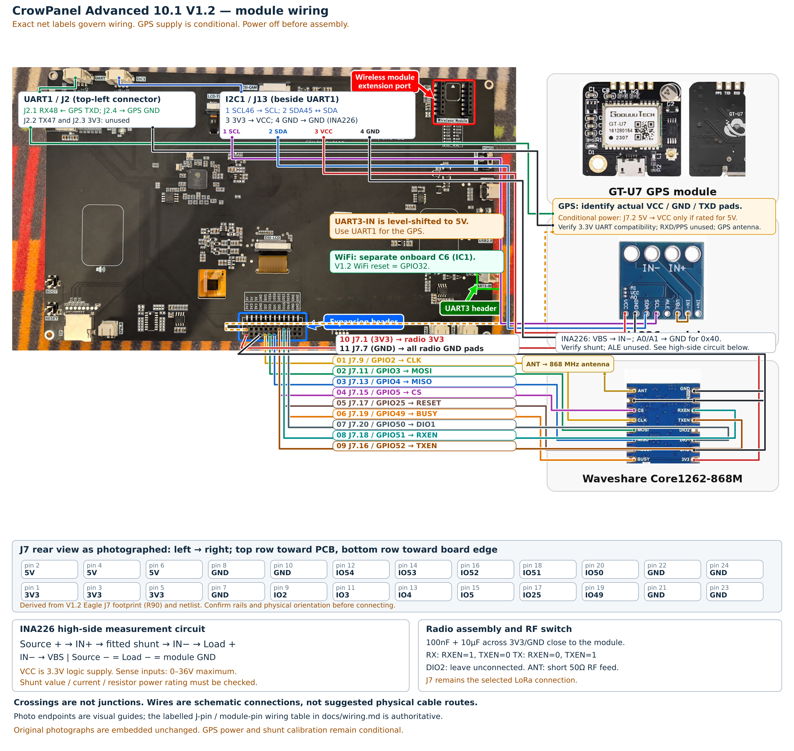
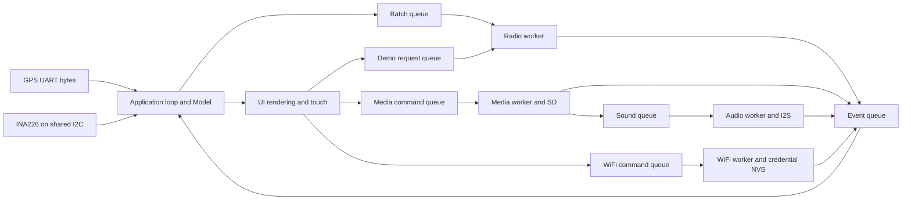

# Documentation: make the CrowPanel template your own

This guide helps you get the template running and understand where to make your
changes. You do not need to know every chip or communication protocol before you
begin. Start with a successful compile, change one small thing on the screen,
and build your understanding from there.

The companion [learning material](../learning/learning-material.md) contains the
exercises, project worksheet and teacher notes. These are the two course
documents. The repository also keeps wiring tables, test records and reviews for
reference; you do not need to read all of them before your first lesson.

## Find what you need

- [Before you connect a board](#01-setup-1-setup-and-first-baseline): identify the kit and prepare local settings.
- [Connect the panel and modules](#panel-and-module-wiring): follow the connection tables and check the supply levels.
- [Compile with Arduino IDE, Arduino CLI or PlatformIO](#build-compile-the-template-arduino-ide-arduino-cli-or-platformio): follow one complete route.
- [How the program shares the work](#02-architecture-2-architecture-and-interfaces): understand the files and background jobs.
- [Create your own screen and application](#03-customization-3-your-ui-and-application-logic): start with a small worked example.
- [Measurements, images, sound and messages](#04-data-and-connectivity-4-data-resources-and-connectivity): find formats and expected behavior.
- [Check your changes and solve problems](#05-testing-and-troubleshooting-5-testing-and-troubleshooting): use evidence to narrow down a problem.
- [Words you may not know yet](#glossary-glossary): a short glossary.

If you only want to compile today, go straight to the build instructions. A board
is not needed for that step. Before connecting or flashing classroom hardware,
ask your teacher which checks have already been completed on your kit. The
project's recorded tests do not yet demonstrate that every physical function works.

<a id="01-setup-1-setup-and-first-baseline"></a>

## 1. Before you begin

Your first goal is a build you can repeat. We call this your **baseline**: the
unchanged starting program, together with the settings used to compile it. If
a later change stops working, you can compare it with that known starting point.

<a id="01-setup-11-check-what-you-have"></a>

### 1.1 Check what you have

You need the CrowPanel Advanced ESP32-P4 **10.1-inch V1.2**, the three specified
modules, the intended power supply and a suitable data-capable UART0 USB cable.
Confirm actual part and board revisions rather than relying on a similar product
photograph. Several CrowPanel models use different processors, pins or displays.

Use the [wiring guide](wiring.md) as the connection reference. In particular:

- The INA226 uses the shared 3.3 V I2C connector J13.
- GPS reception uses J2 UART1 RX; the exact GT-U7 carrier's supply and TXD levels
  must be established before connection.
- The Core1262 uses the documented J7 SPI and control pins. Keep that routing.
- WiFi comes from the onboard C6. The upper-right extension socket is not needed
  for WiFi and is not the radio connection used by this template.

Before radio use, your teacher should check the antenna and the module's clock
and antenna-switch connections. For measurements, use the approved low-voltage
circuit and load. A number that the program can display or send does not tell
you how much voltage or current the physical module can safely handle.

An instructor should approve the physical setup and the intended RF exercise.
Start with compilation and the host exercises while hardware checks are pending.

<a id="01-setup-12-keep-the-sketch-together"></a>

### 1.2 Keep the sketch together

Open the repository's `CrowPanelTelemetry.ino`. Arduino compiles the `.cpp` files
beside it, so copying only the `.ino` is insufficient. Keep these files together:

```text
CrowPanelTelemetry/
  CrowPanelTelemetry.ino
  App.h
  Config.h
  Application.cpp
  Workers.cpp
  Ui.cpp
  SdStorage.h
  Telemetry.h
  ttn-decoder.js
  patches/
  tools/
  tests/
```

The `.ino` delegates to `setupApplication()` and `loopApplication()`. Most student
changes belong in `Ui.cpp` or `Application.cpp`, not in the entry sketch.
The repository is the current template. The delivery ZIP in `artifacts/` is an
older historical snapshot and does not include subsequent corrections.

<a id="01-setup-16-configure-a-local-build"></a>

### 1.3 Choose your local settings

`Config.h` is where you keep the hardware settings and device credentials.
For your first compile, leave the supplied values alone. Before practical work,
check the settings below with your teacher.

| Setting | What you must establish |
| --- | --- |
| `DEV_EUI`, `JOIN_EUI` | The values belonging to your assigned device registration |
| `APP_KEY`, `NWK_KEY` | Both 16-byte root keys for LoRaWAN 1.1 OTAA |
| `INA_SHUNT_OHMS` | The actual fitted shunt resistance |
| `INA_MAX_CURRENT_A` | A calibration limit compatible with the shunt, wiring and PCB |
| `INA_ADDRESS` | The actual address straps, without a shared-bus conflict |
| `GPS_BAUD` | The configured NMEA baud rate of the module |
| `RADIO_TCXO_VOLTAGE` | The value justified by the fitted oscillator supply circuit |
| `AUDIO_FILE` | The selected WAV in the required simple format path on the SD card |

Keep the existing pins. Use blank radio credentials for the initial offline
build; the template then shows configuration status and does not start radio RF.
Do not substitute dummy credentials into a board used for network tests.
`INA_SHUNT_OHMS=0` deliberately leaves current/power uncalibrated. Voltage may
appear locally, but protocol version 1 transmits an invalid triplet for that slot.

Store real credentials only in the instructor-approved local workflow. Do not put
root keys or WiFi passwords in screenshots, shared submissions or a public Git
history. The template's firmware/NVS storage is not encrypted.

<a id="01-setup-18-prepare-resources-and-bring-up-the-board-in-stages"></a>

### 1.4 Prepare files and try the board in stages

A FAT32 SD card should contain:

```text
/images/001.jpg
/images/002.jpg
/audio/demo.wav
```

Use instructor-teacher-checked baseline JPEGs, preferably 600×270, and the exact WAV
format explained in [chapter 4](#04-data-and-connectivity-4-data-resources-and-connectivity). Do not use arbitrary
web downloads as parser stress tests during initial bring-up.

After the hardware checklist permits operation, proceed in stages: display/touch,
known DC sensor load, GPS, prepared SD/audio, C6 WiFi, and finally an approved
LoRaWAN exercise. Check serial output alongside the panel. First sampling occurs
after approximately one minute and a batch becomes available after ten slots.
Neither WiFi nor TTN needs to be configured to study the UI and local data path.
The C6 transport is nevertheless initialized by the baseline WiFi worker even
when no WiFi credentials are entered.

If a stage fails, record the observed message and stop expanding the experiment.
Use [chapter 5](#05-testing-and-troubleshooting-5-testing-and-troubleshooting) to isolate it. Repeated resets
and repeated demo taps are not an appropriate way to accelerate public-network
experiments: reset clears the volatile airtime deadline.

<a id="panel-and-module-wiring"></a>

## Connect the panel and the three modules

You will connect three small boards to the panel: the INA226 measures voltage,
current and power; the GPS receiver reports a position; and the Core1262 sends
LoRaWAN messages. The screen, touch controller, SD socket, audio circuit and WiFi
chip are already on the panel. You do not have to wire those built-in parts again.

Take your time with the connectors. Two wires that fit mechanically are not
necessarily an electrical match. Work with the power disconnected, identify the
label at both ends, and ask a partner to check each connection before power-on.
Use the tables below rather than guessing from the colors in a photograph.

The connection details below are taken from the project's [V1.2 wiring reference](wiring.md).
That reference and `Config.h` remain the places to check when a hardware detail
changes. The pin numbers have not been changed for these student documents.
Some details of the actual modules still need the checks clearly marked below.

### A few labels to know

| Label | What it means when you wire the kit |
| --- | --- |
| GND | The common electrical reference. The panel and modules need the specified ground connections. |
| 3V3 | A 3.3 V supply. It is not interchangeable with 5 V. |
| GPIO | A numbered processor signal. Its job here is set by the software and wiring. |
| J7.9 | Connector J7, contact 9. This is different from GPIO9. |
| TX / RX | Serial transmit / receive. GPS TXD connects to the panel's RX input. |
| SDA / SCL | The two shared I2C signal wires. Match SDA to SDA and SCL to SCL. |
| IN+ / IN− | The current-measurement path through the INA226 shunt, not its logic-power pins. |

### Use the rear view to find the connectors

Read the panel from the back, upright as shown in the image. The board numbers
and connector positions matter; looking into the cable plug reverses the view.
J13 is the sensor connector, J2 is the GPS serial connector, and J7 is the chosen
radio connector. The upper-right wireless extension socket is not used for this
radio connection. WiFi comes from the onboard ESP32-C6.



The picture is an overview. Zoom the [original image](wiring.png) or
[vector version](wiring.svg) when you need to read a small label. For the radio,
**DIO1 goes to J7.20 / GPIO50; DIO2 stays unconnected**. Use the table when a line
in the photograph is hard to follow. GPS power stays disconnected until the
rating of your particular breakout is confirmed.

### The LoRa radio: Core1262-868M / SX1262

WiFi comes from the separate onboard ESP32-C6 (IC1). The upper-right wireless
extension socket is not required for WiFi. The external Core1262 remains on J7
for this template; no socket adapter or pin reassignment is used.

| Panel contact | P4 GPIO / net | Radio pad | Direction at P4 |
|---|---|---|---|
| J7.9 | GPIO2 | CLK | Output, SPI clock |
| J7.11 | GPIO3 | MOSI | Output, SPI data |
| J7.13 | GPIO4 | MISO | Input, SPI data |
| J7.15 | GPIO5 | CS | Output, active low |
| J7.17 | GPIO25 | RESET | Output, active low |
| J7.19 | GPIO49 | BUSY | Input |
| J7.20 | GPIO50 | DIO1 | Input, interrupt-capable |
| J7.18 | GPIO51 | RXEN | Output, RF switch receive control |
| J7.16 | GPIO52 | TXEN | Output, RF switch transmit control |
| J7.1 | 3.3V | 3V3 | Power |
| J7.7 | GND | All exposed GND pads | Common ground / RF return |
| No P4 contact | — | DIO2 | Leave unconnected |
| No P4 contact | — | ANT | 868MHz antenna via short 50Ω RF feed |

Fit 100nF ceramic and about 10µF bulk decoupling close to the radio supply.
Use a suitable carrier for the castellated module, short digital wires, and a
short ground return. Do not run ANT along a breadboard jumper: use a proper
antenna connector/coax and ground layout. Attach the antenna before transmitting.
Radio initialization requests14dBm; LoRaWAN/ADR subsequently controls power up
to a RadioLib request of 16dBm conducted power at TXPower 0. The regional
parameter default is 16dBm EIRP, not conducted power. In 868.0–868.6MHz the
25mW ERP limit is about 13.98dBm ERP / 16.13dBm EIRP. Include antenna gain and
cable loss: EIRP = conducted dBm + gain dBi − loss dB; ERP = EIRP − 2.15dB.
See the [component sources](sources.md). Measure under separately authorized RF testing before operation;
no antenna gain, power cap or compliance is assumed.

RXEN and TXEN are **separate switch inputs**. RX uses RXEN=1/TXEN=0; TX uses
RXEN=0/TXEN=1; idle uses both low. RadioLib controls them through
`setRfSwitchPins()`, and its automatic DIO2 switch output is disabled. The English
Waveshare wiki reverses the RX/TX sentence; its Chinese documentation and the RF
paths on the schematic establish the mapping above. Do not short DIO2 to RXEN.

The published module schematic shows TCXO power from 3V3 through R22, with an
alternative DIO3 ferrite path. The default `RADIO_TCXO_VOLTAGE=0.0f` disables DIO3
supply control for the fixed-supply arrangement. **Population of R22/FB1 on your
actual module is not established by the photograph.** Confirm it before RF bring-up.
If only DIO3 supplies the oscillator, obtain its rated voltage and set that exact
value; do not guess 1.8V or 3.3V. DIO3 needs no external P4 wire.

### INA226 external I2C1 connector J13

J13 sits immediately beside UART1 at the top left. Its contact order, viewed from
the same rear board view, left → right, is **SCL, SDA, 3V3, GND**. Cable mating
views mirror this order; confirm the housing's pin 1 rather than copying a cable
photo. Shared I2C includes the on-board touch controller and audio codec.

| Panel contact | Signal | INA226 pad |
|---|---|---|
| J13.1 | SCL / GPIO46 | SCL |
| J13.2 | SDA / GPIO45 | SDA |
| J13.3 | 3.3V | VCC |
| J13.4 | GND | GND |
| GND | Address strap | A0 and A1, for 0x40 |
| No connection | Alert output | ALE |
| Load-side IN− | Bus sense | VBS |

Inspect existing A0/A1 straps before adding jumpers. Do not short a strap already
connected to another rail. Default software address is 0x40; change `INA_ADDRESS`
if the actual module uses another non-conflicting address. The ES8311 uses 0x18;
touch is normally 0x5D (0x14 is also supported). Start I2C at 100kHz. Existing
pull-ups may suffice; measure bus rise time if long wiring causes errors. All
external pull-ups must go to 3.3V. Do not power this breakout from 5V.

Connect the measured circuit as:

```
source + ---- IN+ ---- fitted shunt ---- IN− ---- load +
                                        |
                                       VBS
source − ------------------------------------- load −
   |
panel/module GND
```

The chip's sensing range is 0–36V and shunt differential range is approximately
±81.92mV. These are chip limits, **not a current rating for the photographed PCB**.
Confirm whether a shunt is installed and its resistance/power rating, then respect
`I × R < 81.9mV` and `I² × R` heating plus connector/trace ratings. For example,
R100=0.1Ω with the default 0.8A calibration gives 80mV and 0.064W in the shunt;
that example is not identification of your board's resistor.

The photo does not establish the shunt value. `INA_SHUNT_OHMS=0` intentionally
keeps current/power unavailable until you enter the real value. Uncalibrated
batches are marked invalid; measured voltage can still appear on screen.
Power sent to TTN is the INA226 power register, not a second U×I calculation.
Power is represented as the monitor's unsigned register output; signed current
is preserved. This template targets a DC source/load measurement, not AC/mains.

### GT-U7 GPS and UART1 J2

J2 is the top-left UART1 connector, **not the right-side UART3-IN**. From the rear
board view, left → right: **RX48, TX47, 3V3, GND**.

| Panel contact | GPS pad | Status |
|---|---|---|
| J2.1 RX / GPIO48 | TXD | Only after confirming TXD is 3.3V-compatible UART |
| J2.4 GND | GND | Common ground |
| J7.2 5V | VCC | **Conditional: connect only if this exact breakout accepts 5V** |
| Unused | RXD | Not needed for NMEA reception |
| Unused | PPS | Not needed |
| Unused J2.2 / J2.3 | — | No wire |

The photograph identifies a GT-U7 family board but not a manufacturer-backed
schematic for its regulator, VCC rating, or UART level. Therefore the GPS power
connection is **not verified for your exact module**. Obtain the seller's exact
specification or inspect its regulator/board first. If it needs regulated 3.3V,
use the documented 3.3V rail instead; do not feed 5V into a bare 3.3V GPS supply.
Do not connect its USB supply simultaneously without verifying the board's power
path. If TXD is 5V or1.8V, use an appropriate UART level translator to3.3V first;
a merely lower-than3.3V high level is not sufficient to guarantee input recognition.

Use 9600 baud NMEA initially; change `GPS_BAUD` if its configured rate differs.
Attach its appropriate GPS antenna and place it with a clear sky view. No GPS RX
wire is needed, so the P4 cannot accidentally reconfigure it.

UART3-IN J10 has 5V-level translation on TX/RX and its VCC is a **power input**.
It is unsuitable as a guessed 3.3V GPS connector or as a GPS power output.

### Complete J7 orientation

The Eagle J7 package is 2×12, rotation R90. As seen in the supplied upright rear
photo, columns run left → right; the even row is toward the board interior and
the odd row toward the lower board edge.

| Column | Top / even contact | Net | Bottom / odd contact | Net |
|---|---|---|---|---|
| 1 | 2 | 5V | 1 | 3V3 |
| 2 | 4 | 5V | 3 | 3V3 |
| 3 | 6 | 5V | 5 | 3V3 |
| 4 | 8 | GND | 7 | GND |
| 5 | 10 | GND | 9 | GPIO2 |
| 6 | 12 | GPIO54 | 11 | GPIO3 |
| 7 | 14 | GPIO53 | 13 | GPIO4 |
| 8 | 16 | GPIO52 | 15 | GPIO5 |
| 9 | 18 | GPIO51 | 17 | GPIO25 |
| 10 | 20 | GPIO50 | 19 | GPIO49 |
| 11 | 22 | GND | 21 | GND |
| 12 | 24 | GND | 23 | GND |

### Built-in peripherals retained

| Function | V1.2 assignment / ownership |
|---|---|
| LCD | Two-lane MIPI DSI; reset41, backlight31, power29 active low |
| GT911 | I2C45/46, reset40, interrupt42; polling ready flag |
| C6 WiFi | SDIO clock18, CMD19, D0=17, D1=16, D2=15, D3=14, reset32 |
| SD card | SDMMC slot0 / one-bit CLK43, CMD44, D0=39 |
| Audio | ES8311 I2C0x18; I2S BCLK22, LRCLK21, data23, MCLK24; amp30 |
| GPS | UART1 RX48; TX47 unused |
| INA226 | Shared I2C45/46, default address0x40 |
| LoRa | Dedicated SPI GPIO matrix mapping on J7, separate from onboard C6 |

On-board microphones, CSI camera, USB host, battery charging telemetry and the
alternative unpopulated NS4168 circuit are outside the requested template scope.

### Power budget

Use the panel's intended regulated5V input and its manufacturer-rated supply/cable;
the documented UART3-IN input rating is5V±5%, up to2A. Expansion5V/3V3 contacts
are supply rails, not arbitrarily interchangeable power inputs. The external I2C
and UART1 ports are specified as3.3V. Confirm total available rail current with the
panel/backlight/WiFi/audio active, rather than treating a connector rating as free
headroom after all on-board loads.

Waveshare lists approximately45mA TX at14dBm and5.3mA receive; the LoRaWAN stack
can request higher power, so do not size the supply to that typical TX value alone.
INA226 itself draws about330µA typical; breakout LEDs/pull-ups can add current.
The exact GT-U7 breakout's current demand remains unverified. During hardware
testing, check3.3V at the radio and5V at the panel during simultaneous audio/WiFi/RF.


### Check together before switching on

1. With power off, let one person read each table row while the other follows
   the actual wire. Confirm the connector contact, signal and module pad.
2. Check common ground and supply rails. Keep 5 V away from 3.3 V signal pins.
3. Confirm the GPS supply and serial levels, the INA226 shunt/address and the
   radio oscillator supply with your teacher. Do not fill in unknown values by
   guessing from a similar board on the internet.
4. Keep the DC experiment within the approved voltage/current range. Connect
   the radio's antenna before any separately approved radio test.
5. Record what was checked in the worksheet. A passed compile does not check
   wiring; a photograph does not establish the rating of a fitted part.

For powered checks and later tests, use the [hardware checklist](hardware-checklist.md)
with your teacher. Stop and disconnect power if a supply voltage is wrong or a
component becomes unexpectedly warm.

<a id="build-compile-the-template-arduino-ide-arduino-cli-or-platformio"></a>

## Compile the template: choose Arduino or PlatformIO

Use this guide before changing the UI or application logic. Your first milestone
is to compile the supplied template with blank radio credentials and record how
you did it. You do not need a connected panel, SD card, GPS fix or TTN account to
complete that milestone.

All three routes build the same application. Choose one for your first build;
you do not have to install and learn all three. You can change tools later without
moving the firmware into a different project.

| Route | Choose it when | What you use |
| --- | --- | --- |
| [Arduino IDE](#build-route-a-arduino-ide) | You prefer menus, an editor and a Verify button | Arduino IDE with Espressif's pinned board package |
| [Arduino CLI](#build-route-b-arduino-cli) | You want repeatable terminal commands and saved logs | Arduino CLI 1.5.1; optionally the repository Makefile |
| [PlatformIO](#build-route-c-platformio) | You prefer PlatformIO or VS Code | Core 6.2.0 and the repository's pinned `platformio.ini` |

You are in the documentation. Work through the route you choose, then return
to the first exercise in the learning material. The build settings live in the
repository configuration files; the commands here show you how to use them.

<a id="build-1-prepare-the-source-and-your-build-record"></a>

### 1. Prepare the source and your build record

Get the current course repository from your instructor. Keep the whole
`CrowPanelTelemetry` folder, including the root `.ino`, `.cpp` and `.h` files,
`patches/` and `tools/`. Copying only the `.ino` leaves out the application.
Do not start from the historical ZIP in `artifacts/`.

Open a terminal in the repository root: the directory containing
`CrowPanelTelemetry.ino`, `Makefile` and `platformio.ini`. All commands below start
there. Paths beginning with `/absolute/path/` are placeholders you must replace;
put quotes around your real paths, especially if they contain spaces.

The terminal examples use Bash on Linux/macOS. On Windows, the Arduino IDE route
uses the same board settings, but terminal commands need an appropriate shell
and installed tools. PowerShell environment-variable examples are given where
useful; the recorded build validation was performed on Linux.

Start section 2 of your [worksheet](../learning/learning-material.md#project-worksheet-2-reproducible-baseline).
Record the assigned source revision. In a Git checkout, these read-only commands
help identify it and any local changes:

```sh
git rev-parse HEAD
git status --short
```

Leave the delivered radio credentials blank for the first compile. Leave pin
assignments unchanged. `INA_SHUNT_OHMS=0` is the deliberate uncalibrated starting
configuration; it is sufficient for compilation. Hardware calibration comes later.

<a id="build-2-prepare-one-shared-library-collection"></a>

### 2. Prepare one shared library collection

Ask the instructor for the exact dependency collection, or obtain the complete
release sources using the [pinned release links](../README.md#dependencies).
Do not select a newer release just because a package manager offers it.

A convenient layout supports all three routes:

```text
course-sketchbook/
  libraries/
    Arduino_GFX/library.properties
    RadioLib/library.properties
    INA226/library.properties
    TinyGPSPlus/library.properties
    JPEGDEC/library.properties
    audio-driver/library.properties
```

Each listed folder must contain the complete library, including its source
files. `library.properties` must be directly inside the named folder, rather than
inside another release-named subdirectory. The project itself stays in its
existing repository directory, outside this collection.

| Folder | Required release | Extra preparation |
| --- | --- | --- |
| `Arduino_GFX` | 1.6.9 | None |
| `RadioLib` | 7.8.1 | Apply the current project patch |
| `INA226` | 0.6.6 | None |
| `TinyGPSPlus` | v1.0.3a | None |
| `JPEGDEC` | 1.8.4 | Apply the current project patch |
| `audio-driver` | 0.3.1 | None |

Some upstream metadata is stale: the exact JPEGDEC 1.8.4 sources report 1.2.7,
and TinyGPSPlus v1.0.3a reports 1.0.3. Record the release source as well as the
build's displayed version. Do not edit library metadata to hide the difference.
Wire, SPI, WiFi, Preferences and ESP_I2S come with the Arduino core. You do not
need LVGL or a collection copied from a CrowPanel demo.

Set `DEPS` to the absolute path of the **libraries directory**, not its parent:

```sh
export DEPS="/absolute/path/to/course-sketchbook/libraries"
python3 tools/patch_dependency.py radiolib-7.8.1 "$DEPS/RadioLib"
python3 tools/patch_dependency.py jpegdec-1.8.4 "$DEPS/JPEGDEC"
```

You need Python 3 and the standard `patch` executable for this step. In PowerShell,
the corresponding variable and patch commands are:

```powershell
$env:DEPS = 'C:/absolute/path/to/course-sketchbook/libraries'
python tools/patch_dependency.py radiolib-7.8.1 "$env:DEPS/RadioLib"
python tools/patch_dependency.py jpegdec-1.8.4 "$env:DEPS/JPEGDEC"
```

**Checkpoint:** both commands must finish successfully. They check exact source
hashes and also accept an already correctly patched library. If a command refuses
the source, check the selected release and whether an older patch was applied.
Obtain clean sources of the required release instead of bypassing the checks.
A successful compile alone does not prove that JPEGDEC is patched.

Use these same physical folders for every build route. This avoids fixing a
library in one location while compiling another copy elsewhere.

<a id="build-3-identify-the-board-configuration"></a>

### 3. Identify the board configuration

Ask the instructor which P4 silicon revision is fitted. The panel PCB's V1.2
label is not the chip revision.

| Actual P4 silicon | Arduino Chip Variant | CLI option | PlatformIO environment | CPU |
| --- | --- | --- | --- | --- |
| Before v3.00 | Before v3.00 | `prev3` | `crowpanel-prev3` | 360 MHz |
| v3.00 or newer | v3.00 or newer | `postv3` | `crowpanel-postv3` | 400 MHz |

Both use 16 MB flash, PSRAM enabled, QIO flash at 80 MHz and the
`app3M_fat9M_16MB` partition. That partition reserves about 3 MB for the application
and an internal FAT area; it does not format or replace the removable SD card.
Use UART0 for the initial serial/upload workflow, USB CDC on boot disabled and
115200 baud for the serial monitor. Keep erase-all-flash disabled.

If the actual silicon is not yet known, record that uncertainty. A compile for
one target is useful evidence, but it is not enough to select firmware to flash.

<a id="build-route-a-arduino-ide"></a>

### Route A: Arduino IDE

<a id="build-a1-install-or-select-the-board-package"></a>

#### A1. Install or select the board package

Use the instructor's Arduino IDE installation, or follow the
[official IDE installation guide](https://support.arduino.cc/hc/en-us/articles/360019833020-Download-and-install-Arduino-IDE).
Record your IDE version; the repository's automated Arduino evidence uses CLI
1.5.1 rather than an automated test of the IDE's graphical interface.

1. Open Preferences (called Settings in some desktop versions).
2. Add the following Additional Boards Manager URL, retaining any other URLs
   required by your course:

   ```text
   https://espressif.github.io/arduino-esp32/package_esp32_index.json
   ```

3. Open **Tools → Board → Boards Manager**, search for `esp32`, and locate
   **esp32 by Espressif Systems**.
4. Select **3.3.12** explicitly and install that version if it is not already
   available. It supplies the matching ESP-IDF 5.5.5 components. Do not accept an
   automatic upgrade for this exercise.

Arduino describes package selection in its
[Boards Manager instructions](https://support.arduino.cc/hc/en-us/articles/360016119519-Add-boards-to-Arduino-IDE).
Changes on managed classroom computers should be arranged with the instructor.

<a id="build-a2-point-the-ide-at-the-prepared-libraries"></a>

#### A2. Point the IDE at the prepared libraries

In Preferences, set Sketchbook location to the `course-sketchbook` directory from
section 2. Its `libraries/` subdirectory is your `DEPS`. Restart the IDE if needed
for library discovery. This changes where the IDE looks for user libraries; it
does not require moving the template into that sketchbook.

Open **File → Open** and select the existing `CrowPanelTelemetry.ino`. Check that
the application `.cpp` and `.h` files remain beside it. Do not create an empty
sketch and paste only the `.ino` contents into it.

<a id="build-a3-set-the-target-and-compile"></a>

#### A3. Set the target and compile

Select **Tools → Board → esp32 → ESP32P4 Dev Module**, then check the Tools menu:

| Setting | Value |
| --- | --- |
| Chip Variant | The actual silicon choice from section 3 |
| CPU frequency | Selected by Chip Variant: 360 MHz for `prev3`, 400 MHz for `postv3` |
| Flash Size | 16 MB |
| PSRAM | Enabled |
| Flash Mode / Flash Frequency | QIO / 80 MHz |
| Partition Scheme | 16M Flash (3MB APP/9.9MB FATFS) |
| USB Mode | USB-OTG (TinyUSB), the default mode value 0 |
| USB CDC On Boot | Disabled |
| Erase All Flash Before Sketch Upload | Disabled |
| Upload Speed | 115200 |

USB Mode names the native USB configuration; it does not select the physical
UART0 connector. Keep CDC on boot disabled for this baseline.
Menu wording can differ by IDE version; the package must still be 3.3.12.
Enable verbose output during **compilation** in Preferences so you can inspect
library selection. Click the **Verify** checkmark, rather than Upload. A serial
port and connected board are not needed for Verify.

<a id="build-a4-check-and-save-the-result"></a>

#### A4. Check and save the result

Wait for the entire build to finish. Save the output showing successful completion,
flash/RAM usage and selected library paths. Check that the external libraries
come from your prepared collection. If the IDE reports multiple candidates, use
the path it actually selected to determine whether the correct source was built.

Record the Tools settings and IDE version in your worksheet. A Verify result
shows that a firmware image can be built; it does not demonstrate display, touch,
WiFi, GPS, sensor, audio or radio operation. Continue with section 4 below.

<a id="build-route-b-arduino-cli"></a>

### Route B: Arduino CLI

<a id="build-b1-check-the-tools-and-installed-core"></a>

#### B1. Check the tools and installed core

Use the instructor-provided **Arduino CLI 1.5.1**, or obtain that exact version
using the [official CLI installation options](https://docs.arduino.cc/arduino-cli/installation/).
Put its executable on your shell's `PATH`, then check:

```sh
arduino-cli version
arduino-cli core list
```

The version must be 1.5.1 and the installed Espressif core must include
`esp32:esp32` **3.3.12**. If the core is missing, use the board-package preparation
from route A or ask the instructor to prepare the CLI's own configured data
directory. Different CLI/IDE configurations can point at different installations;
the `core list` from the CLI you will compile with is the relevant check.

<a id="build-b2-build-using-the-repository-makefile"></a>

#### B2. Build using the repository Makefile

With `DEPS` still set, run the following if your computer has `make`. Use a
repository/build path without spaces for this route: the existing Makefile does
not quote every generated-directory argument. The direct CLI alternative below
quotes its paths.

```sh
make compile \
  ARDUINO_CLI=arduino-cli \
  LIBRARIES="$DEPS" \
  BUILD="$PWD/build/codex/student-baseline" \
  FQBN='esp32:esp32:esp32p4:FlashSize=16M,PSRAM=enabled,PartitionScheme=app3M_fat9M_16MB,ChipVariant=prev3'
```

Replace only `ChipVariant=prev3` with `ChipVariant=postv3` for newer silicon.
If the CLI is not on `PATH`, replace `ARDUINO_CLI=arduino-cli` with
`ARDUINO_CLI="/absolute/path/to/arduino-cli"`.

`FQBN` identifies the board package, board and menu options. `LIBRARIES` directs
library discovery to the prepared collection. `BUILD` keeps generated output,
cache and temporary files under the ignored `build/codex/` directory.
The target compiles without uploading.

<a id="build-b3-or-call-the-cli-directly"></a>

#### B3. Or call the CLI directly

This Bash equivalent does not require `make`. Its verbose output is useful when
checking dependency selection. Use this instead of B2, not as a required second
build:

```sh
mkdir -p build/codex/student-cli/tmp build/codex/student-cli/cache
TMPDIR="$PWD/build/codex/student-cli/tmp" \
ARDUINO_BUILD_CACHE_PATH="$PWD/build/codex/student-cli/cache" \
arduino-cli compile --verbose \
  --fqbn 'esp32:esp32:esp32p4:FlashSize=16M,PSRAM=enabled,PartitionScheme=app3M_fat9M_16MB,ChipVariant=prev3' \
  --libraries "$DEPS" \
  --build-path "$PWD/build/codex/student-cli/output" \
  .
```

The final `.` means the existing sketch in the current directory. Again, change
the Chip Variant for newer silicon. Save the complete successful output and
memory summary. Inspect the Used library paths, not only the displayed metadata
version. Continue with section 4.

<a id="build-route-c-platformio"></a>

### Route C: PlatformIO

<a id="build-c1-use-the-existing-project-configuration"></a>

#### C1. Use the existing project configuration

Open the repository containing `platformio.ini`. Do not create a new PlatformIO
project, move files into `src/`, or copy the firmware. The configuration already
selects pioarduino **55.03.312**, Arduino core **3.3.12**, the partition and both
P4 environments. Its local-library references use your `DEPS` collection.

Use **PlatformIO Core 6.2.0**, pinned in `requirements-platformio.txt`. If the
instructor has already provided it, check `pio --version` and go to C2. Otherwise,
these Bash commands prepare an isolated Core inside the ignored build directory:

```sh
python3 -m venv build/codex/platformio-cli
build/codex/platformio-cli/bin/python -m pip install -r requirements-platformio.txt
export PATH="$PWD/build/codex/platformio-cli/bin:$PATH"
pio --version
```

This requires Python's virtual-environment support and network access for package
downloads. Windows virtual environments use `Scripts` instead of `bin`.
An older Core is not a compatible substitute for this pinned platform.

<a id="build-c2-compile-from-the-terminal"></a>

#### C2. Compile from the terminal

Set `DEPS` in the terminal that will run the build. Choose **one** command matching
the silicon:

```sh
pio run -e crowpanel-prev3
```

```sh
pio run -e crowpanel-postv3
```

The first build downloads the pinned platform, framework and compiler packages.
Allow several gigabytes of disk space and enough time for those downloads.
Packages go into `build/codex/platformio-core/`; workspace files go into
`build/codex/platformio/`. They do not replace your Arduino installation.

Wait for the final **SUCCESS** result, not just compilation of the last source
file. Save the dependency graph and flash/RAM summary. The `symlink://` libraries
must resolve to the prepared `DEPS` folders.

Use ordinary `pio run`, **without `-v`**: the pinned Core/framework combination
has a known verbose-mode logging failure during binary generation. An ELF left
behind by a failed command is not a completed successful build. For additional
configuration information, use:

```sh
pio project metadata -e crowpanel-prev3 --json-output
```

Substitute the newer environment when appropriate. If you need a clean rebuild,
use `pio run -e crowpanel-prev3 -t clean` for that environment, then build again.
Do not delete the prepared libraries as part of cleaning outputs.

<a id="build-c3-optional-use-vs-codes-platformio-extension"></a>

#### C3. Optional: use VS Code's PlatformIO extension

1. Install or open the instructor-provided PlatformIO IDE extension.
2. Launch VS Code with this repository as the open folder. Make sure its process
   receives `DEPS`; with the `code` command available, run `code .` from the
   prepared terminal. An editor that was already running may need to be closed
   and relaunched to inherit the variable.
3. In the extension settings, disable `platformio-ide.useBuiltinPIOCore` and set
   `platformio-ide.customPATH` to the directory containing the selected 6.2.0
   `pio` executable. For the local example, that is the absolute path to
   `build/codex/platformio-cli/bin`.
4. Confirm `pio --version` and `DEPS` in the PlatformIO terminal. Check the Build
   task's resolved library paths as well; a terminal variable alone does not prove
   that a previously started editor inherited it.
5. In Project Tasks, select `crowpanel-prev3` or `crowpanel-postv3` and **Build**.
   Avoid Upload for the compile-only baseline.

The recorded validation covers the command-line builds. The extension's graphical
workflow has not been physically or interactively verified in this project.

<a id="build-4-finish-the-baseline-and-continue-the-lesson"></a>

### 4. Finish the baseline and continue the lesson

Complete this checklist regardless of your selected route:

- [ ] Source revision and local changes recorded.
- [ ] Exact library releases obtained; both patch checks passed.
- [ ] Selected library paths point to the prepared collection.
- [ ] Core 3.3.12 and the intended silicon/partition configuration confirmed.
- [ ] Full build completed successfully; exact command or IDE settings saved.
- [ ] Flash and static-RAM usage recorded, with the complete build log.
- [ ] Blank radio credentials retained for the offline baseline.
- [ ] Compile evidence labelled separately from hardware evidence.

Once your baseline record is complete, continue with Lesson 1 in the
learning material. After each small change, compile again and compare the result
with your starting build.

Your teacher may also ask you to run checks on your computer. Follow the
[host-check instructions](#05-testing-and-troubleshooting-52-host-checks) later
in this document. Those checks do not emulate the ESP32. PlatformIO's `pio test`
is not the test command configured for this project. If a required tool is
missing, record that rather than marking the check as passed.

<a id="build-5-switch-tools-without-changing-the-application"></a>

### 5. Switch tools without changing the application

Keep the same source, `Config.h`, dependency folders and patches when switching
between Arduino and PlatformIO. Use **one active builder at a time** in this
checkout. PlatformIO temporarily creates `CrowPanelTelemetry.ino.cpp` beside the
sketch and normally removes it on exit. An interrupted build can leave it behind;
after confirming no builder is running, remove only that generated intermediate
before an Arduino build. Do not edit or submit it as application source.

Uploading either workflow's output replaces the firmware on the panel. Two build
routes do not create two independently running applications. Binary sizes can
differ between build systems even when source and relevant configuration match;
record which workflow produced each result.

<a id="build-6-if-compilation-fails"></a>

### 6. If compilation fails

| Symptom | Check first | Useful next action |
| --- | --- | --- |
| A header cannot be found | Complete source/library layout and `DEPS` | Check `library.properties` is directly under each named folder and inspect selected paths |
| Patch tool refuses the source | Exact tag, old patch or locally modified vendor file | Preserve your work and obtain a clean copy of the pinned release |
| Radio callback/API is missing | Stock or wrong RadioLib selected | Recheck the current patch and actual compiler-selected library path |
| P4 board or Chip Variant is missing | Wrong Arduino core or PlatformIO platform | Compare with the pinned versions, not a generic ESP32 setup tutorial |
| PlatformIO cannot resolve a library link | `DEPS` in the build process environment | Set its absolute path and relaunch the editor if necessary |
| PlatformIO fails in binary-generation logging | Use of `-v` with the pinned stack | Run the documented ordinary build; retain any other error for diagnosis |
| Duplicate sketch definitions after switching tools | Leftover generated `.ino.cpp` | Stop builders, identify the intermediate and remove only that generated file |
| Build succeeded, but a device function fails | Compile evidence cannot establish physical operation | Use the hardware checklist and serial diagnosis with your instructor |

Bring the **first meaningful error**, complete build log, selected versions and
exact command/settings to a help session. Do not change several library versions
at once; that destroys the reproducible baseline you need for diagnosis.

Flashing is a separate practical step. Use the [hardware checklist](hardware-checklist.md)
and the [bring-up reference](#01-setup-18-prepare-resources-and-bring-up-the-board-in-stages)
with your instructor. RF testing requires its own approved setup; a compile-only
exercise does not require an upload or network join.

<a id="02-architecture-2-architecture-and-interfaces"></a>

## 2. How the program shares the work

Think of the program as a small team. One part looks after the screen, another
handles files, and another talks to the radio. Each part has a clear job. In this
guide, we call that responsibility **ownership**. For example, pressing Play
asks the sound-handling code to do some work; the button itself does not read and
play the whole file. This keeps the screen available for the next tap.

<a id="02-architecture-21-the-source-files-have-different-jobs"></a>

### 2.1 Where to find the code you want to change

| File | Responsibility | Typical student change |
| --- | --- | --- |
| `CrowPanelTelemetry.ino` | Delegates Arduino setup/loop to the application | Usually none |
| `Config.h` | Pin and credential configuration | Assigned credentials, verified calibration, application configuration |
| `App.h` | Shared model, command/event types and public interfaces | A genuinely new piece of application state or message contract |
| `Application.cpp` | UI model, GPS parsing, sample scheduler, live sensor I2C and event handling | Application rules, derived state, integration of results |
| `Ui.cpp` | Display drawing, screen navigation, touch decoding, button actions | Your interface, layout, labels and interaction flow |
| `Workers.cpp` | Radio/NVS, WiFi, media and audio workers | A change to a worker's actual responsibility, when required |
| `SdStorage.h` | Slot-0 lifecycle used by the media worker | Normally unchanged |
| `Telemetry.h` | Reading/batch types, binary encoder and pacing decisions | Only a deliberate data/protocol change |
| `ttn-decoder.js` | Matching network-side decoder | Must change together with a changed message format |

`AGENTS.md` records the ownership/build contract. Consult it before changing a
boundary. A helper file is not a reason to add a second implementation of the same
rule or a second owner for a peripheral.

<a id="02-architecture-22-startup-establishes-the-hardware-boundaries"></a>

### 2.2 What happens when the program starts

`setupApplication()` begins by putting the amplifier into shutdown, starts serial
logging, then initializes Wire on GPIO45/46. Sensor discovery and ES8311 setup
run before worker tasks start. A temporary I2S clock is used during codec setup.
GPS UART reception and the display/touch setup follow.

`startWorkers()` creates queues, then radio, WiFi and audio tasks. The WiFi task
starts the media task after `WiFi.mode()` returns. This orders the application's
initialization calls; it does **not** serialize SDMMC traffic with Hosted traffic.

Finally, the application schedules the first sample for one minute later. The UI
model is initialized before normal touch processing. Some display-driver failures
abort inside the dependency, so the program may panic/reboot before worker startup;
there is no guaranteed on-screen error page for that failure.

<a id="02-architecture-23-runtime-data-flow"></a>

### 2.3 Follow a reading or a button press



A button sends a request. The worker performs the slow operation. A later event
updates the model. On its next refresh the UI presents the result. Queue acceptance
and operation completion are separate moments.

For example, **Send demo** means that a demo request entered its one-item queue.
The radio may still be joining or waiting for airtime. Only a later radio event
can describe the send result. Even a local completed transmission does not prove
that a gateway received the unconfirmed packet.

<a id="02-architecture-24-execution-contexts-and-peripheral-ownership"></a>

### 2.4 Who looks after each device

A worker is a background job. It can spend time connecting or reading a file
while the main part of the program continues handling the screen. The priority
and stack-size details below are for reference; leave them unchanged for the
normal student project. A stack is memory a job uses while its functions run.

| Context | Owns during normal operation | Baseline task configuration |
| --- | --- | --- |
| Arduino application loop | Model, GPS parsing, sensor traffic, drawing, touch and shared live I2C | Core-managed `loopTask` |
| Radio worker | SX1262, its SPI bus, LoRaWAN state and `crow-lora` NVS | Priority 2; 12,288-byte stack |
| WiFi worker | Connection requests/status and `crow-wifi` credentials | Priority 1; 8,192-byte stack |
| Media worker | Slot-0 SD lifecycle, directory/file reads, JPEG decoding and sound-file loading | Priority 1; 24,576-byte stack |
| Audio worker | Playback I2S instance, amplifier playback control and sound-buffer disposal | Priority 2; 6,144-byte stack |

The application's codec initialization is an explicit startup exception to live
I2C ownership. After startup, do not add codec volume writes from the audio task:
they would use the shared Wire bus outside its owner. A future runtime volume
feature needs a deliberate owner-preserving interface.

A separate task does not guarantee responsiveness. Radio busy waits, priorities,
rendering cost and shared SDK activity still matter. Runtime stack margins and
latency have not been measured on the physical system. Adding a worker or increasing
a priority is not a routine solution to a slow interface.

<a id="02-architecture-25-the-model-is-a-snapshot-for-presentation"></a>

### 2.5 The Model holds what the screen needs

`Model` contains the latest `Reading`, GPS/status strings, acquisition minute,
batch progress, lost-batch count and sensor/calibration status. `Application.cpp`
owns its lifetime. `updateUi(Model&, bool)` stores a pointer to this same object;
there is no independent UI measurement cache.

Workers do not write `model` directly. They send events. The application drains
those events and changes the appropriate field. Keeping this boundary prevents a
radio callback from modifying display objects while the UI is drawing.

The UI has its own private state for which screen is open, keyboard editing,
touch-down detection and the displayed image buffer. These describe interaction,
not a second version of the sensor or LoRaWAN state.

If your interface needs a value that can be computed from existing fields, derive
it while rendering or in the application rule that needs it. For example, a low
voltage caption does not need a second stored copy of the voltage. A latched alarm
that remembers a past event does need state; assign that state to the application.

<a id="02-architecture-26-queue-contracts"></a>

### 2.6 Requests waiting to be handled

A queue is a short waiting list inside the program. A button puts a request on
that list, and a background job picks it up. Each list has a fixed capacity, so
the program also needs a clear response when it is full. The names in the table
below are the names you will find in the source code.

The queues are created in `startWorkers()` and their types are in `App.h` or
locally in `Workers.cpp`.

| Queue | Item and capacity | Producer → consumer | Meaning of a full queue |
| --- | --- | --- | --- |
| `events` | `Event`, 24 items | Workers → application | Worker sends block until space is available |
| `batches` | `Batch`, 6 items | Application → radio | The newly completed batch is dropped and `lostBatches` increases |
| `demoRequests` | One-byte request, 1 item | UI → radio | Another demo is already waiting |
| `mediaCommands` | `MediaCommand`, 4 items | UI → media | UI reports that the media queue is full |
| `wifiCommands` | `WifiCommand`, 1 item | UI → WiFi | `xQueueOverwrite` replaces an older pending request |
| `sounds` | `Sound` pointer/length, 1 item | Media → audio | The new buffer is freed and the media error is reported |

The remaining details in this section are useful when you change background
work or handle image and sound memory. For a first screen redesign, it is enough
to know which existing command to send and how to show the result.

A `Batch` is copied into the queue. A `WifiCommand` contains fixed-size arrays and
is copied too. `Event.text` is a fixed-size array. These values do not depend on
a producer's temporary stack buffer after a successful send.

Image and sound items are different: the queue copies a **pointer**, not the data
behind it. That requires a clear transfer of allocation ownership.

<a id="02-architecture-27-allocation-ownership-images-and-sound"></a>

### 2.7 Who keeps and releases image and sound memory

For images, the media worker reads compressed bytes, decodes a 600×270 RGB565
canvas into PSRAM, frees the compressed input and queues an image event. When
`presentImage()` receives it, it frees the previous canvas, adopts the new pointer
and sets `event.pixels` to null. The application's subsequent `free(event.pixels)`
is therefore harmless. If the display cannot accept the image, that application
cleanup still releases the allocation.

For sound, the media worker allocates and loads PCM bytes. If queueing fails, it
frees them. If queueing succeeds, the audio worker owns the buffer and frees it
after playback or a reported failure. The currently playing sound is outside the
queue; one additional buffer may be waiting.

When adding an image screen, use the existing retained image through the UI owner.
Do not save another owning pointer and free both copies. When creating a different
media flow, write down who allocates, who owns after each successful send, who
handles send failure, and who eventually frees the data.

<a id="02-architecture-28-timing-and-validity"></a>

### 2.8 When readings happen, and what missing data means

`loopApplication()` regularly drains GPS input and worker events. Touch is polled
at approximately 20 ms intervals; ordinary screen status refresh is about once
per second. A forced redraw is used for screen transitions and image changes.
The loop ends with a short 5 ms delay. These are scheduling intentions, not measured
maximum response times.

Sampling uses `nextSample`, advancing by 60,000 ms per slot. It does not reschedule
from the end of a slow conversion, which would accumulate drift. If deadlines are
missed, old slots become invalid instead of pretending new readings were taken at
those past times. The current slot can contain a real conversion. The conversion-ready wait is
requested with a 60 ms timeout; I2C reads and other work add their own cost. This
is not a measured whole-loop latency bound. Long work added here delays GPS,
touch and event draining.

The default `Reading{}` contains NaN. That is an unavailable value, distinct from
a real zero. The UI prints `--` for non-finite values. The version-1 encoder marks
the whole triplet invalid if any of its values is unavailable or outside its range.

<a id="02-architecture-29-boundaries-to-preserve-during-customization"></a>

### 2.9 Four questions before you change something

Before changing a behavior, answer four questions:

1. Which owner has the original input and stored values?
2. Is this a UI choice, an application decision, a worker operation or a protocol change?
3. What result is visible before completion, on failure and after success?
4. Which existing test or user-visible check proves that behavior?

A layout change normally stays in `Ui.cpp`. A measurement interpretation belongs
in the application. A file operation belongs in the media worker. A message-format
change affects both encoder and decoder. This classification is more useful than
adding a new task whenever a feature crosses a file boundary.

<a id="03-customization-3-your-ui-and-application-logic"></a>

## 3. Your UI and application logic

You can replace the dashboard with your own design. Start with a small change
that you can see, such as a label. Then decide what the readings mean for the
person using your application. This section shows where to make those changes.
The examples are for you to try; they are not already added to the template.

<a id="03-customization-31-start-with-a-one-page-application-brief"></a>

### 3.1 Start with a one-page application brief

Write down the intended user, the decision they need to make, the measurements
that support that decision, and what your application does when data is missing.
For a classroom DC supply monitor, a useful brief might be:

> A student should be able to see whether the test supply is within its expected
> range, inspect the most recent real measurement, and distinguish a low reading
> from a missing sensor. The application shows an advisory indication; it does not
> switch the physical load.

Specify the nominal test supply and the instructor-approved operating range. A
number called “low voltage” has no meaning until the measured system is defined.
List the screens and transitions, then sketch the layout at 1024×600. Decide where
WiFi, media errors, GPS freshness, radio status and dropped batches remain visible.

<a id="03-customization-32-know-which-ui-code-to-edit"></a>

### 3.2 Know which UI code to edit

`Ui.cpp` uses Arduino_GFX directly. It contains the display construction, colors,
`Rect` hit testing, drawing helpers, private `Screen` state, `tap()` and polling.
There is no widget tree or background UI framework to synchronize.

| What you want to change | Existing place to inspect |
| --- | --- |
| Card positions, colors, text or labels | `updateUi()` and local drawing helpers |
| Image frame and media buttons | `drawImage()` and the corresponding `Rect` values |
| Dashboard/WiFi/downlink navigation | `Screen`, `tap()` and `updateUi()` |
| A screen's refresh behavior | Its branch in `updateUi()` |
| A button's behavior | Its hit-test branch in `tap()` |
| Touch hardware/orientation | `beginUi()`, `pollTouch()`, `readTouch()`; hardware-dependent |

Keep display bus timing, panel initialization and pin settings separate from your
visual design. Moving a card does not require changing the DSI constructor.
The baseline requests 51 MHz and the pinned divider yields nominal 48 MHz; neither
is a reason to tune timing to repair a layout mistake.

<a id="03-customization-33-worked-example-an-honest-voltage-caption"></a>

### 3.3 Worked example: an honest voltage caption

This example adds a caption to the existing voltage card. It does not take another
sensor reading, send another packet or create an alarm task.

First, define the classroom threshold once in `Config.h`, outside `namespace Pins`:

```cpp
// Classroom example for a specified 5 V DC supply; choose with your instructor.
constexpr float SupplyLowVoltage = 4.8f;
```

Then, inside `updateUi()`'s dashboard branch, replace the existing `labels` declaration
with these declarations. Leave the existing values, units and drawing loop in place:

```cpp
const char* voltageLabel = !std::isfinite(model.reading.voltage)
                              ? "VOLTAGE / NO DATA"
                              : (model.reading.voltage < SupplyLowVoltage ? "VOLTAGE / LOW" : "VOLTAGE");
const char* labels[] = {voltageLabel, "CURRENT", "POWER"};
```

This code goes into the existing dashboard drawing function. The card loop already draws `labels[n]` and `model.reading` values. A missing
reading produces “NO DATA”; a real 0 V reading produces “LOW”. The threshold does
not claim that 4.8 V is suitable for every power system.

For this change, test NaN, 0 V, just below 4.8 V, exactly 4.8 V and above it. Check
that captions fit within the card and do not leave old text on screen. The existing
refresh clears the card before drawing, which handles a long-to-short label change.

If the low-voltage decision later drives batching, an acknowledged alarm or another
application behavior, move the shared decision to the application owner. Do not
repeat slightly different comparisons in the UI, network encoder and logger.

<a id="03-customization-34-build-your-own-dashboard"></a>

### 3.4 Build your own dashboard

A useful sequence is:

1. Keep the current model fields and draw them in your layout.
2. Move the matching hit rectangles with each visual control.
3. Test screen transitions and forced redraws.
4. Add application-specific presentation such as units, a range bar or an advisory caption.
5. Only then add new application state if the requirements need memory or new input.

`Rect::contains` includes the left/top edge and excludes the right/bottom edge.
Use the same rectangle for drawing and hit testing where possible. Leave enough
space between actions to avoid accidental activation. Test a held touch: the
baseline triggers on the first down event, not continuously while held.

Keep drawing in the UI context. Use `model` passed to `updateUi()`; do not access
`meter`, `gps`, `WiFi`, `SX1262` or SD files from a drawing function. A renderer
should finish promptly using already-available values.

When entering a new screen, the background and controls need a full draw. Periodic
refresh should update the information that can change while that screen stays
open. The existing downlink screen demonstrates this: a newly received message
must appear without the user closing and reopening it.

If your layout removes the original dashboard footer, provide an equally clear
place for sensor errors, calibration state, batch progress and drop counts. These
are part of the meaning of the data, not optional decoration.

<a id="03-customization-35-add-application-rules-at-their-owner"></a>

### 3.5 Put each decision in one place

Some decisions only need the latest reading: “Is the voltage low right now?”
Others need to remember something: “Has the voltage been low since I last
checked?” Decide which question you want to answer before adding variables.
For example:

| Requirement | Appropriate approach |
| --- | --- |
| Show whether the current voltage is below a limit | Derive from the latest valid reading |
| Keep a warning until the user acknowledges it | Application-owned state that remains set until cleared and an acknowledgement interface |
| Avoid changing warning state near a noisy threshold | One application-owned state machine with documented hysteresis |
| Display a historic minimum since boot | One application-owned accumulator updated once per valid sample |
| Save a user setting across reboot | A defined persistence owner, format and failure behavior |

Do not infer a sample event from the one-second screen refresh: that would count
the same one-minute reading repeatedly. A rule that processes each new measurement
belongs at the sampling boundary in `Application.cpp`. Apply it to the real current
slot only; a missed invalid slot must not become a real zero or a fabricated sample.

Write a small transition table before implementing a stateful feature. Include
missing data, startup, a valid zero, recovery, acknowledgement and reboot. Decide
whether state is recomputed or persisted. Avoid new flags when an enum can express
the actual mutually exclusive states.

For an action handled by the application/UI loop itself, a short application
function may be enough. It does not automatically need a new task and queue. If
the action needs a worker-owned device, use or deliberately extend that worker's
command interface. Explain any new boundary before adding it.

<a id="03-customization-36-connect-controls-to-existing-commands"></a>

### 3.6 Connect controls to existing commands

The existing Previous/Next/Play/Remount actions all use `mediaCommands`:

```cpp
MediaCommand command = MediaCommand::Next;
bool queued = xQueueSend(mediaCommands, &command, 0) == pdTRUE;
if (!queued) {
    latest->media = "Media queue full / wait for current operation";
}
```

This fragment belongs inside a `Ui.cpp` action where `latest` is already valid.
It illustrates the existing interface; do not add a second Next sender for the
same tap. The `0` timeout keeps the UI from waiting for queue space. The worker's
later event reports the operation result.

A new navigation button that only selects a screen changes UI state. It should
not send a peripheral command just to trigger a redraw. Conversely, a Play button
must not call `fopen()` or I2S writes directly.

For WiFi, retain the typed `WifiCommand` with its bounded arrays and one-item
`xQueueOverwrite` behavior. Preserve password clearing, input validation and the
worker's verified-save condition. Do not show a configuration as saved simply
because a request was queued.

<a id="03-customization-37-handle-downlinks-according-to-the-requirement"></a>

### 3.7 Receiving a message from the network

The baseline presents downlinks as escaped text with their application port.
That is sufficient for a message viewer. It is not a typed control protocol.
A nonprintable byte becomes a textual `\xNN` escape for display.

The same principle applies to GPS: `model.gps` is a formatted status string. If
your rule needs numeric coordinates, expose typed values from the existing GPS
owner rather than parsing display text or starting another UART parser.

If your application needs structured commands, first define a versioned payload,
valid lengths, supported port, permitted values, result/error reporting and whether
a repeated command is meaningful. Then define how the radio owner transfers the
original payload to the application owner. Do not build a command parser by
splitting `model.downlink`: it is formatted presentation text and may contain
escapes. Such a feature changes an interface and requires coordinated tests; it
is beyond a visual redesign exercise.

<a id="03-customization-38-change-telemetry-deliberately"></a>

### 3.8 If you want to change the data being sent

An on-screen advisory derived from existing readings need not change the uplink.
If you do change transmitted data, update `Telemetry.h`, `ttn-decoder.js`, the
protocol description and reference/encoder/decoder tests as one change. Decide
how old receivers recognize the new version. Recalculate the maximum size and
pacing behavior at the slowest supported rate with pending MAC commands.

Do not change the sample period or add a transmission on every threshold crossing
without analyzing acquisition meaning, queue capacity and airtime. A useful local
feature can remain local while the existing radio policy sends measured data.

<a id="03-customization-39-review-your-change-before-moving-on"></a>

### 3.9 Review your change before moving on

Explain which file owns each new value and action. Check startup, missing input,
queue full, stale data, screen reopening and recovery. Run the checks relevant to
the changed boundary. Keep a small diff and compare it with the baseline before
adding the next feature. A student application should be understandable from its
requirements and tests, not only from a successful demonstration.

<a id="04-data-and-connectivity-4-data-resources-and-connectivity"></a>

## 4. Measurements, files and connections

A useful screen helps someone understand what is happening. To build one, you
need to know what a measurement means and how recent it is. You also need to know
whether a message is still waiting, has been sent, or has actually arrived. This
section explains those differences and the files the template can use.

<a id="04-data-and-connectivity-41-a-reading-contains-three-values-not-three-validity-flags"></a>

### 4.1 A zero reading is different from a missing reading

`Reading` has floating-point voltage, current and power. Its default constructor
sets all three to NaN. Finite zero is meaningful: an unloaded circuit can have
zero current. It must remain distinguishable from a missing or failed conversion.

The INA226 is configured and read by the application on the shared I2C bus. A
scheduled acquisition checks connectivity, calibration-write status, completed
conversion, register errors, math overflow and the calibrated/shunt range. Failed
or saturated triplets become unavailable. A current at or above the configured
calibration maximum is rejected; leave operating margin below that limit.

Shunt resistance is essential to current calibration. The voltage drop is roughly
`I × R`, and shunt heating is `I² × R`. A chip's 36 V sense range does not rate the
module's screw terminals or load circuit for a particular current. Inspect the
actual board and use the [wiring reference](wiring.md).

With `INA_SHUNT_OHMS=0`, local voltage can still be finite. Current and power remain
unavailable, so the version-1 wire encoder marks the **entire triplet** invalid.
Do not interpret an invalid TTN slot as proof that the bus voltage was zero.

The UI formats two decimal places. Those characters do not establish measurement
accuracy. Shunt tolerance, calibration, ADC range and wiring all affect accuracy;
the wire format also quantizes values.

<a id="04-data-and-connectivity-42-acquisition-time-and-transmission-time-are-separate"></a>

### 4.2 Taking a reading and sending it happen at different times

The application creates one sample slot each minute from uptime minute 1. Ten
slots form one `Batch`. A slot exists even if its measurement is invalid.
`Batch.firstMinute` identifies the first slot, and indices 0–9 identify the rest.

A batch enters the six-item queue after its tenth slot. Once joined, the radio
worker can hold an additional active batch while fragmenting or waiting. This
is RAM buffering, not a durable log. If the queue is full, the new batch is dropped
and the UI's cumulative dropped count increases. Reboot loses queued data.

At a slow data rate, delivery can fall behind acquisition. A received packet may
therefore describe older measurements. Use the encoded uptime minute, not the
server reception timestamp, to understand ordering. Uptime is not UTC; the baseline
does not map GPS time into the telemetry protocol.

<a id="04-data-and-connectivity-43-gps-status-has-two-different-questions"></a>

### 4.3 GPS status has two different questions

The GPS transmits NMEA over UART. `TinyGPSPlus::encode()` identifies a completed
checksum-valid sentence. The application uses that to track recent valid input.
A valid sentence may still report no location fix.

A location is displayed only when valid and younger than 10 seconds. Satellites
have their own validity and age checks. The two main unavailable states are:

| Status | Interpretation |
| --- | --- |
| No valid NMEA / check UART, baud | No recent checksum-valid sentence; investigate wiring, power or baud |
| No fresh fix / move antenna outdoors | Recent valid input exists, but a fresh usable position does not |

The parser's permissive checksum helper has documented limits. This status is an
operational aid, not a certification of arbitrary UART data. Do not keep a stale
coordinate on your redesigned UI without visibly labelling it as stale.

<a id="04-data-and-connectivity-44-sd-image-contract"></a>

### 4.4 Which image files to use

The media worker mounts the card at `/sdcard`. Files on the card use ordinary paths
such as `/images/001.jpg`; application `fopen()` calls prepend the mount path.
Up to 128 regular JPG/JPEG files are collected and sorted by filename. The first
image is loaded after a successful mount, and Previous/Next wrap around the list.

Use baseline JPEG, at most 4 MiB compressed input. The decoder selects full, half,
quarter or eighth scale for the 600×270 display canvas. A source that still does
not fit after scaling is rejected. A 600×270 baseline image avoids scaling surprises;
edge dimensions may hit the existing conservative scaling boundary.

The patched JPEGDEC rejects specified malformed SOF metadata and deliberately
ignores EXIF interpretation. It does not apply EXIF orientation or expose extracted
thumbnail metadata. Progressive JPEG is rejected by the application. Other decoder
bounds remain known limitations, so use teacher-checked files for classroom bring-up.
The patch is not a complete malformed-file validation system.

Retry SD requests a remount and directory rescan. An ordinary no-card failure can
be retried; an unmount error latches storage unavailable until restart. SD and C6
Hosted share the controller, and runtime coexistence is unverified. Do not promise
that every remount is independent of WiFi; a Hosted transport failure can reset
the P4. Treat coexistence stress as an instructor-run hardware experiment.

<a id="04-data-and-connectivity-45-wav-playback-contract"></a>

### 4.5 Which sound files to use

The baseline accepts a specific, simple file layout:

- RIFF/WAVE with a canonical 44-byte header.
- PCM format 1, stereo, 16-bit little-endian samples, 48,000 Hz.
- A 16-byte `fmt ` chunk immediately followed by `data` at the expected offsets.
- Positive PCM data length divisible by four, at most 4 MiB and within the file.

Stereo 16-bit audio uses four bytes per frame. At 48,000 frames per second, 4 MiB
is about 21.8 seconds. MP3, AAC, extra WAV metadata chunks and other sample formats
are outside the accepted baseline contract. A `.wav` extension alone is insufficient.

The repository overview provides an ffmpeg conversion example. Check the actual
resulting header because tools can include additional chunks. Keep copyright and
licensing information for resources you distribute to students.

The media worker loads the complete PCM buffer before queueing playback. The audio
worker writes it to I2S and frees it afterward. GPIO30 is HIGH for amplifier shutdown
and LOW while playing and draining. The ES8311 is mono; stereo input framing does
not establish separate left/right audio channels at the speakers. Its driver also
has retained false-success error paths, so setup success does not prove every
codec register was written correctly.

<a id="04-data-and-connectivity-46-wifi-and-lorawan-serve-different-purposes"></a>

### 4.6 WiFi and LoRaWAN serve different purposes

The P4 talks to its onboard C6 through ESP-Hosted SDIO to obtain WiFi. Compatible
C6 slave firmware is required. WiFi can be configured from the touchscreen with
SSID and Personal password, or an empty password for an open network. Enterprise
and captive-portal flows are not implemented.

After an accepted request reaches an active WiFi connection, an IP address and the requested
SSID, the WiFi worker saves one credentials blob in NVS. Queue acceptance, link
association, IP acquisition and successful persistence are different steps. The
UI reports failures rather than promising they all succeeded at Connect.

LoRaWAN uses the external SX1262 module and a gateway connected to a network
server. Panel WiFi is not the LoRaWAN transport. A working access point connection
does not establish a gateway path or a successful OTAA join.

<a id="04-data-and-connectivity-47-ttn-configuration-and-keys"></a>

### 4.7 TTN configuration and keys

Use the device registration assigned by the instructor: LoRaWAN MAC **1.1.0**,
Regional Parameters **1.0.4**, EU868 frequency plan, OTAA and Class A. Configure
`DEV_EUI`, `JOIN_EUI`, `APP_KEY` and `NWK_KEY` to match it. EUI macros are integer
hex values in displayed order; root keys are 16-byte lists. Do not byte-reverse
those example representations. No MQTT client ID or manually entered session keys
are needed for the radio's OTAA activation.

Both 1.1 root keys are required. All-zero example keys or zero DevEUI keep radio
operation disabled; negotiated 1.0 is rejected. `JOIN_EUI=0` is not inherently an
error if it matches the assigned registration.

The radio stores nonce state and a boot ID in `crow-lora`. Before a join, it
reserves the next DevNonce durably. An uncertain transmission cannot cause reuse
of the old nonce. A storage/version failure stops RF. Reboot creates a fresh OTAA
session rather than restoring uncertain uplink counters. Ordinary upload is not
an instruction to erase nonce NVS. Coordinate credential/registration recovery
with the instructor; do not repeatedly clear state to bypass a join failure.

<a id="04-data-and-connectivity-48-uplinks-downlinks-and-class-a"></a>

### 4.8 Uplinks, downlinks and Class A

An **uplink** travels from the panel through a gateway to TTN. A **downlink** travels
from TTN through a gateway to the panel. Class A opens receive windows after an
uplink; it does not listen continuously. A server-queued message therefore waits
for a suitable next uplink and available network resources.

The template uses:

| Application port | Direction/use |
| --- | --- |
| FPort 1 | Binary measurement fragment uplink |
| FPort 2 | Four-byte ASCII `DEMO` uplink |
| For example FPort 10 | Instructor-chosen application downlink text |

FPort 0 carries protocol MAC commands and is not an application-command port.
The baseline displays the application port and printable text, escaping binary
bytes as `\xNN`. A zero-length application message is labelled empty. A downlink
screen left open refreshes when a new message arrives.

Paste the repository's `ttn-decoder.js` into the assigned TTN uplink formatter.
The decoder is stateless: it decodes one fragment, not an entire stored device
history. A local TX-completed event means the chip completed its operation; these
uplinks are unconfirmed and gateway reception is not guaranteed.

<a id="04-data-and-connectivity-49-version-1-packet-reference"></a>

### 4.9 A closer look at the message format

You can use the existing messages without changing how they are packed. This
part is useful when you reach the message-decoding exercise or want to change
the data being sent. A byte is eight bits; packing several values together keeps
the radio message short.

A full ten-sample batch is `7 + 10 × 4 = 47` application bytes. Multi-byte fields
are big-endian. The [airtime/protocol specification](airtime.md) is authoritative.

| Byte offset | Size | Meaning |
| --- | --- | --- |
| 0 | 1 | Version, currently 1 |
| 1 | 2 | Boot ID |
| 3 | 3 | Batch's first sample uptime minute |
| 6 | 1 | High nibble: sample offset; low nibble: sample count |
| 7 onward | 4 per sample | Packed voltage/current/power or invalid sentinel |

Each sample uses 11 voltage bits at 0.02 V, signed 11 current bits at 0.01 A, and
10 power bits at 0.1 W. `FFFFFFFF` represents an invalid triplet. Valid zero is
`00000000`. Representable application ranges are 0–36 V, −10.23 to +10.23 A and
0–102.2 W; sensor calibration and hardware ratings can be much narrower.

At limited payload allowance the worker fragments without changing sample order.
With 36 application bytes available, the first seven samples use 35 bytes and the
remaining three use 19. The descriptor bytes are `0x07` and `0x73`. A backend can
group fragments by device identity, boot ID and first sample minute, then deduplicate
sample indices. Those identifiers wrap and are not globally permanent IDs.

<a id="04-data-and-connectivity-410-airtime-limits-what-every-ten-minutes-can-mean"></a>

### 4.10 Why messages may take longer than ten minutes to arrive

A batch becomes available every ten sample slots. It is not guaranteed to arrive
at TTN every ten minutes. At slower spreading factors, sending all batches that
frequently exceeds the configured public-network airtime allowance. The template
keeps acquisition regular and slows transmission instead.

`PersistentNode` maintains one volatile deadline. It accounts for the aggregate
predicted airtime of each completed join/send operation, including internal frames,
then extends the deadline using the stricter applicable allowance. It does not
reserve or gate every physical internal frame. Reboot clears the deadline;
repeated resets can exceed allowances. This is a documented teaching trade-off.

Failed cold-boot joins start with a one-minute backoff base and progress toward
DR0. Failure backoff eventually caps at 24 hours, with 0–60 s pseudo-random jitter
added after the maximum existing hold. After a successful join, a later in-run
session restart uses a 64-minute base and DR0. A replacement session also initially
uses DR0 for data uplinks until network ADR changes it, so throughput can be much
slower after that restart. Do not diagnose a paced queue as a frozen UI.

Use the airtime calculator and host tests for accelerated classroom reasoning.
Public-network RF tests should follow the instructor's plan and current network
rules. Changing a pacing macro to make a demo faster is a policy change with
regional and network consequences.

<a id="05-testing-and-troubleshooting-5-testing-and-troubleshooting"></a>

## 5. Testing and troubleshooting

A useful test answers a specific question. Compiling checks whether your chosen
code, libraries and settings can be built together. Tests on your computer can
check message encoding or a timing decision. To check where a finger touches the
screen, how the antenna switch behaves or what the speakers produce, you need
the actual board.

<a id="05-testing-and-troubleshooting-51-record-a-baseline-and-a-small-change"></a>

### 5.1 Record a baseline and a small change

Before editing, record the source revision, local changes, board settings,
dependency versions and selected paths. State the behavior you intend to change
and the behavior that must remain. After editing, inspect the diff and run the
checks for that boundary.

For a label/layout change, compilation, formatting and the relevant visual/touch
checks are useful. For a changed encoder, run encoder/decoder/reference tests and
recalculate sizes. For a changed background job, use its existing test with the actual application
code and check both success and failure. A new check should assert the behavior, not
merely compare two copies of the same calculation.

<a id="05-testing-and-troubleshooting-52-host-checks"></a>

### 5.2 Host checks

The development host needs a C++17 compiler, Python 3, Node.js, `make`,
`clang-format`, the standard `patch` command and the six exact isolated dependencies.
The host C++ compiler is separate from the ESP32 target compiler used by Arduino.

From the repository root:

```sh
export DEPS=/absolute/path/to/dependencies
RADIOLIB_DIR="$DEPS/RadioLib" make -k format-check test \
  BUILD="$PWD/build/codex/student-tests"
```

`make -k` lets independent Make targets continue after another target fails.
Inside `tools/test.py`, independent checks also continue and failures are reported
together. A missing `RADIOLIB_DIR` is a failed prerequisite, not a passing skip.
Its parent directory must contain the named sibling libraries used by the runners.

| Check area | What it establishes | Important limit |
| --- | --- | --- |
| Codec and JavaScript decoder | Packet/reference agreement, ranges, invalid sentinel and fragments | Not gateway delivery |
| Airtime reference | Formula and size/policy calculations | Not a measured RF waveform |
| Radio integration | Real patched RadioLib with extracted production node/worker logic | Simulated time/RF/NVS; host time types differ |
| INA226 acquisition | Real library with transport-level injected errors and production acquisition | Not real calibration accuracy |
| GPS status | Real parser plus extracted freshness logic | Not antenna reception or field probability of noise |
| JPEG admission | Real decoder test examples and sanitizer/bounds checks | Does not cover every possible invalid image or memory access |
| SD lifecycle | Slot accounting/failure behavior through a test that runs on the computer | Not Hosted concurrency or card electronics |
| WiFi form/worker | Validation, requests and persistence decisions | Not real C6 association/event timing |
| Amplifier/audio path | Extracted playback/GPIO ordering | Not actual speaker polarity, pops or audio quality |

`make format` formats project-owned C++ files. Review what it changes, then use
`make format-check`. Vendor sources are excluded. Some tests copy a marked section of the actual application code into a test
program. If you reorganize that section, the test may need help finding it again.
Keep testing the real code rather than replacing it with a separate version
that only exists to make the test pass.

Target clang-tidy was attempted in the recorded baseline but the installed LLVM
cannot process the ESP-specific GCC flags/target headers. That is a known analysis
limit, not a clean static-analysis result. Do not weaken the configuration to
turn the limitation into a reported pass.

<a id="05-testing-and-troubleshooting-53-inspect-a-packet-without-ttn-or-rf"></a>

### 5.3 Inspect a packet without TTN or RF

Run the matching decoder directly with Node.js:

```sh
node - <<'JS'
const fs = require('fs');
const {decodeUplink} = require('./ttn-decoder.js');
const bytes = JSON.parse(fs.readFileSync('tests/reference-packet.json', 'utf8'));
console.log(JSON.stringify(decodeUplink({fPort: 1, bytes}), null, 2));
JS
```

The test example includes ordinary values, invalid triplets and a valid zero. This lets
you study data semantics without waiting ten minutes or sending a public-network
packet. The values are a test example; do not present them as measured board data.

<a id="05-testing-and-troubleshooting-54-observe-the-ui-and-asynchronous-actions"></a>

### 5.4 Observe the UI and asynchronous actions

For each control in your interface, write a short table containing:

- What the user requests.
- What appears immediately if queueing succeeds or fails.
- Which later event means completion.
- Which failures can arrive after queue acceptance.
- How the user can retry or recover.

Test screen reopening, a held touch, taps on edges and simultaneous status updates.
For a derived warning, include missing data, valid zero, exact boundary and recovery.
If the interface becomes slow, first remove long work from its render/touch path.
A longer waiting list does not make the part doing the work any faster.

<a id="05-testing-and-troubleshooting-55-troubleshooting-by-symptom"></a>

### 5.5 Start with what you can observe

| Observation | Likely boundary to investigate | First useful check |
| --- | --- | --- |
| Display init panic/reboot, no dashboard | DSI driver or board configuration | Read serial before worker startup; verify actual board/timing settings |
| Touch works until an I2C error, then stops | Intentional GT911 error latch | Repair shared bus, inspect levels/pull-ups, then restart |
| Voltage appears but current/power are `--` | Calibration configuration | Confirm actual shunt and `INA_SHUNT_OHMS`; inspect sensor status |
| All TTN triplets invalid despite local voltage | Version-1 all-three-values validity rule | Check calibration and finite current/power |
| First reading not yet visible | One-minute initial deadline | Check uptime and wait for slot 1 |
| No valid NMEA | GPS UART/power/baud boundary | Verify module voltage/TXD and configured baud, inspect serial evidence |
| Valid input, no fresh fix | GPS position solution | Use appropriate antenna and sky view |
| SD ready but no images | Directory or scan | Check `/images`, extension, regular files and names |
| JPG failed | File read, size, baseline type, scale or decoder | Try a curated 600×270 baseline image |
| WAV/codec error | WAV contract, allocation or codec readiness | Check header/length and serial status; try curated short PCM |
| C6 unavailable | Hosted initialization/firmware | Compare host/slave logs; restart after resolving setup |
| Connection request failed | STA request rejected | Check SSID/password and actual connection state; do not infer saved credentials |
| Radio asks to fill credentials | Deliberate blank configuration gate | Check assigned EUIs and both root keys locally |
| Radio init failed | SPI, BUSY/reset, supply, TCXO or RF-switch setup | Inspect wiring and serial return code before testing RF |
| Joined but demo stays queued | Airtime hold or current batch | Inspect radio status, active work and configured policy |
| Batch queue grows at slow data rate | Acquisition exceeds delivery capacity | Use airtime calculation; preserve drop visibility |
| New downlink does not arrive immediately | Class-A receive opportunity/network path | Check next permitted uplink and server queue, within test plan |
| SD action resets the panel | Shared SDMMC/Hosted risk | Stop the stress sequence; capture reset/Hosted logs with instructor |

A symptom can have several causes. Change one justified variable, repeat the
relevant check, and keep the evidence. A generic library update, flash erase or
pin reassignment removes the baseline you are trying to diagnose.

<a id="05-testing-and-troubleshooting-56-hardware-acceptance-and-retained-limits"></a>

### 5.6 Hardware acceptance and retained limits

The [hardware checklist](hardware-checklist.md) is the complete reference. For
a student project, the instructor should identify which physical checks have
already been performed on the supplied kit and which are still open.

Retained limits include shared SD/Hosted lifecycle behavior, possible whole-P4
restart on Hosted failure, ES8311 false-success paths, nested MAC recursion,
unmeasured stack/latency margins and incomplete malformed-JPEG coverage. The radio
also has documented network-side edge cases. Use teacher-checked files on the SD card and the assigned
network setup; a host PASS does not close these items.

Test antenna/power/TCXO/RF-switch behavior, GPS levels, sensor shunt, display/touch
orientation and real audio separately. Do not apply mains or an unspecified high
current to a teaching breakout. The public-network airtime/deployment conditions
remain in force even when the software is a classroom template.

<a id="05-testing-and-troubleshooting-57-what-to-submit-with-an-application"></a>

### 5.7 What to submit with an application

Provide your application brief, screen map, screenshots labelled as mockup or actual
hardware capture, a short ownership/data-flow explanation, a clean configuration
example without secrets, dependency/build settings and relevant test evidence.
Explain any protocol change with both encoder and decoder updates. Include known
limitations and exactly which physical checks were performed. Keep host simulation,
compile success and device operation as separate evidence categories.

<a id="glossary-glossary"></a>

## Glossary

| Term | Meaning in this template |
| --- | --- |
| Application rule | A decision derived from data, such as whether a valid supply reading is below the experiment's threshold. |
| Owner | The part of the program responsible for a device or stored value. Other parts ask it to do work. |
| Model | The latest readings and status messages that the screen uses. |
| Task / worker | A background job, such as handling the radio or reading files, that runs alongside the main Arduino loop. |
| Queue | A waiting list of requests or results. It has a fixed amount of space. |
| Backpressure | What happens when requests arrive faster than they can be handled: the waiting list grows or becomes full. |
| Event | A result or status message sent back by a background job. |
| PSRAM | External RAM used for large image/audio allocations; it is not persistent storage. |
| NVS | Settings kept in flash memory across restarts, including WiFi credentials and radio join counters. |
| I2C | Shared two-wire bus used here by sensor, touch controller and codec. |
| SPI | Clocked serial interface used for the external LoRa radio. |
| UART / NMEA | Serial transport / sentence format used by the GPS receiver. |
| I2S / PCM | Audio transport / numerical audio sample representation. |
| DMA | Hardware transfer support that can leave a short audio tail after the last application write. |
| NaN | Floating-point “not a number,” used to represent unavailable readings. |
| Quantization | Representing a measurement in fixed increments, such as 0.02 V per transmitted step. |
| LoRa | The radio modulation used by the SX1262. |
| LoRaWAN | The network protocol managing activation, counters, MAC commands and receive windows. |
| OTAA | The join process that uses your assigned device identity and keys to establish a network session. |
| DevNonce | A number used when joining LoRaWAN. The template saves it so a restart does not cause it to be reused. |
| Uplink / downlink | Device-to-network / network-to-device message direction. |
| Class A | Receive windows following an uplink, rather than continuous listening. |
| FPort | A number describing what a LoRaWAN message is for. Port 0 is reserved for network-control messages. |
| ADR / DR / SF | Adaptive Data Rate / data-rate index / spreading factor. A slower rate usually needs more airtime. |
| MAC command / FOpts | Network-control command / header field that can carry MAC commands and reduce application allowance. |
| RekeyInd / RekeyConf | LoRaWAN 1.1 session key confirmation exchange relevant to the in-run session-restart path. |
| Airtime | Time occupied by an actual or predicted radio frame on the channel. |
| Jitter | A varying extra retry delay that helps avoid synchronized retries. |
| Fragment | Part of one batch, carrying an offset/count so sample order is preserved. |
| ESP-Hosted | The transport/software arrangement through which the P4 uses the separate C6 WiFi device. |
| FQBN | Arduino's board identifier plus selected build options. |
| Host test | A check running on the development computer with an explicit harness, separate from target firmware operation. |
